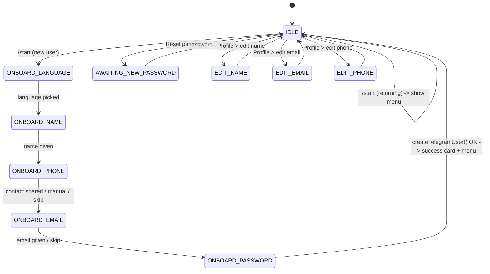

# Gotcha Telegram Bot — Flow Architecture

Status: **Design / pre-build**. This document is the source of truth for the new
"professional" Telegram bot onboarding + control surface. Build phases are at the
bottom.

---

## 1. Goals

1. **More professional signup** — collect richer profile data during registration:
   - Full name
   - Phone number (native Telegram "Share contact" button)
   - Email
   - Preferred language (UZ / RU / EN)
2. **More user control inside the bot** — a menu-driven surface (inline keyboards +
   commands menu) for: download the app, view/edit profile, reset password, change
   language, see subscription, get help.
3. **Cross-platform app delivery from the bot** — a "Download app" action that serves
   **both Android and iOS**:
   - **Android**: the bot **sends the `.apk` file straight through Telegram** (as a
     document). An admin uploads the APK to the bot itself; the bot stores the Telegram
     `file_id` and re-sends it instantly to every user.
   - **iOS**: **"coming soon" at launch.** iOS cannot install apps from a file the way
     Android can — Apple only allows installs via the App Store / TestFlight (see §7.3a).
     When an iOS build exists, the iOS button serves an **App Store / TestFlight link**
     (configured by the admin). Until then it shows a localized "coming soon" message.
4. **Multilingual** — every bot message available in Uzbek, Russian, and English.
5. **Feedback / support** — a "Feedback" button lets users message the team directly.
   The bot replies with a friendly acknowledgment, and the message lands in the **web
   admin panel** (see `ADMIN_PANEL_ARCHITECTURE.md`), where an admin can reply; the reply
   is delivered back to the user through the bot (two-way support chat).

### Explicit non-goals / locked decisions

- **Login identifier is unchanged**: users still sign in to the app with their
  **numeric Telegram ID + password**. The new fields are *profile data only*.
- **No verification** of phone or email (no SMS/email OTP). Values are stored as
  provided. (Phone shared via Telegram contact is implicitly trusted by Telegram.)
  We leave clearly-marked hook points so OTP can be added later without rework.

---

## 2. Current system (baseline)

| Piece | Today |
|---|---|
| Bot runtime | Telegraf, **webhook mode**, `internalUserOps: true` (DB ops run in-process, no HTTP self-calls) |
| Handlers | `backend/src/telegram/attachHandlers.js` — `/start`, `/reset_password`, `text` |
| Session state | `telegram_bot_sessions(telegram_id, step, updated_at)`; `step ∈ {idle, awaiting_password, awaiting_new_password}` |
| User ops | `backend/src/services/botUserOperations.js` (`lookup/create/reset`) |
| HTTP bot routes | `backend/src/routes/bot.js` (`/bot/lookup-user`, `/bot/create-user`, `/bot/reset-password`) — used only in non-internal mode |
| Webhook entry | `backend/src/routes/telegramWebhook.js` |
| Users table | `id, username(=telegram_id), password_hash, telegram_id (unique), created_at` |
| App login | `POST /auth/login { id, password, device_id }` → JWT; numeric Telegram ID is the username |
| App entry to bot | Login screen "Open Telegram Bot" deep-links to `t.me/<bot>` |

The flow today: `/start` → (new user) "send me a password" → `createTelegramUser` →
"your ID is N, use it + password in the app".

---

## 3. Target architecture overview

```
                       ┌─────────────────────────────────────────────┐
   Telegram update     │            telegramWebhookRouter             │
  ───────────────────► │  (verifies X-Telegram-Bot-Api-Secret-Token)  │
                       └───────────────────┬─────────────────────────┘
                                           │ bot.handleUpdate(update)
                                           ▼
                       ┌─────────────────────────────────────────────┐
                       │              attachHandlers.js               │
                       │  Router by (state, input type)               │
                       │  ┌──────────────┬──────────────────────────┐ │
                       │  │ command/menu │ onboarding state machine │ │
                       │  └──────┬───────┴───────────┬──────────────┘ │
                       └─────────┼───────────────────┼────────────────┘
                                 │                   │
                ┌────────────────┘                   └───────────────┐
                ▼                                                     ▼
   ┌─────────────────────────┐                        ┌───────────────────────────┐
   │ sessionStore (jsonb)    │                        │ botUserOperations          │
   │ step + partial profile  │                        │ create/lookup/reset/update │
   └──────────┬──────────────┘                        └─────────────┬─────────────┘
              ▼                                                      ▼
        telegram_bot_sessions                                     users (+ profile cols)
```

New/changed building blocks:

1. **`users` profile columns** + a **migration**.
2. **Session store** extended to hold partial onboarding data (jsonb) and the user's
   chosen language.
3. **i18n module** — `t(lang, key, vars)` with `uz/ru/en` message catalogs.
4. **Keyboards module** — inline keyboards (language picker, main menu, download,
   profile), reply keyboard for contact sharing.
5. **State-machine refactor** of `attachHandlers.js` (replaces the current 3-state
   `if/else` chain).
6. **`botUserOperations` extensions** — accept/return profile fields; add
   `updateTelegramUserProfile`.
7. **Config** — APK download URL + Play/web links, all env-driven.

---

## 4. Data model changes

### 4.1 `users` — new profile columns (nullable, additive, non-breaking)

```sql
-- backend/db/migration_bot_profile_<date>.sql
alter table users add column if not exists full_name        text;
alter table users add column if not exists email            text;
alter table users add column if not exists phone_e164       text;
alter table users add column if not exists language         text not null default 'uz';
alter table users add column if not exists profile_completed_at timestamptz;
alter table users add column if not exists updated_at       timestamptz not null default now();

-- Email is optional but should be unique when present.
create unique index if not exists users_email_unique
  on users (lower(email)) where email is not null;

create index if not exists users_phone_idx on users (phone_e164);
```

- `language ∈ {uz, ru, en}`.
- `phone_e164` stored normalized (`+998...`). No verification, but Telegram's
  `contact.phone_number` is authoritative when the user shares their own contact.
- Existing users keep `null` profile fields → they are prompted to "complete profile"
  (see §7.4). Nothing about their login breaks.

### 4.2 `telegram_bot_sessions` — carry partial onboarding data + language

```sql
-- same migration file
alter table telegram_bot_sessions add column if not exists data jsonb not null default '{}'::jsonb;
alter table telegram_bot_sessions add column if not exists language text;
```

- `data` holds in-progress onboarding values, e.g.
  `{ "full_name": "...", "phone_e164": "+998...", "email": "..." }`, cleared on
  completion/cancel.
- `language` lets us localize messages even before a `users` row exists.

### 4.3 `app_artifacts` — per-platform app delivery

One table represents the "current build" per platform. Delivery differs by platform:

- **Android** (`platform = 'android'`): a `.apk` is uploaded **into the bot** by an
  admin and delivered via Telegram's document API (no external hosting). Telegram
  returns a `file_id` on first upload; we persist it and re-send by `file_id` (instant,
  no re-upload, no size cost). Uses `file_id`.
- **iOS** (`platform = 'ios'`): there is no file to send — iOS cannot install
  sideloaded apps. The admin configures an **App Store or TestFlight URL**. Uses
  `store_url`.

```sql
create table if not exists app_artifacts (
  id              bigserial primary key,
  platform        text not null,                      -- 'android' | 'ios'
  version_name    text,                               -- e.g. '1.0.0' (from upload caption)
  -- Android delivery (file sent through Telegram):
  file_id         text,                               -- Telegram file_id (reusable to re-send)
  file_unique_id  text,                               -- Telegram file_unique_id (dedupe)
  file_name       text,                               -- e.g. 'gotcha-1.0.0.apk'
  size_bytes      bigint,
  -- iOS delivery (link, since sideloading is not allowed):
  store_url       text,                               -- App Store / TestFlight URL
  uploaded_by     bigint,                             -- admin telegram_id
  is_current      boolean not null default false,     -- the build users receive
  created_at      timestamptz not null default now(),
  -- exactly one delivery mechanism per row
  constraint app_artifacts_delivery_chk
    check ((file_id is not null) <> (store_url is not null))
);
create unique index if not exists app_artifacts_current_idx
  on app_artifacts (platform) where is_current;
```

- Marking a new artifact `is_current = true` atomically clears the previous current one
  **for that platform** (so "Download app" always serves the latest per platform).
- **Android format note**: `.aab` is a Play Store publishing bundle and is **not
  directly installable** by users — the artifact sent from Telegram must be an **`.apk`**.
- **Android size note**: a bot can *upload* files up to ~50 MB via the Bot API. Once
  stored as `file_id`, re-sending has no practical size concern. If the APK exceeds
  50 MB, fall back to a hosted-link delivery (env `APK_DOWNLOAD_URL`).
- **iOS note**: `.ipa` cannot be sideloaded by general users; only an App Store /
  TestFlight link is viable. No file is stored.

### 4.4 (Optional) `bot_events` — lightweight analytics

```sql
create table if not exists bot_events (
  id bigserial primary key,
  telegram_id bigint,
  event text not null,            -- 'start', 'signup_complete', 'download_click', 'lang_change', ...
  meta jsonb not null default '{}'::jsonb,
  created_at timestamptz not null default now()
);
create index if not exists bot_events_event_idx on bot_events (event, created_at desc);
```

Useful for "how many people clicked download" / funnel drop-off. Can be Phase 5.

---

## 5. Session state machine

Replace the 3-state model with an explicit machine. States live in
`telegram_bot_sessions.step`.

```
STATES = {
  IDLE,                       // registered user at rest; menu available
  ONBOARD_LANGUAGE,           // choosing UZ/RU/EN (inline)
  ONBOARD_NAME,               // awaiting full name (text)
  ONBOARD_PHONE,              // awaiting contact share (reply keyboard) or manual/skip
  ONBOARD_EMAIL,              // awaiting email (text) or skip
  ONBOARD_PASSWORD,           // awaiting password -> creates user
  AWAITING_NEW_PASSWORD,      // reset password (existing behavior, kept)
  EDIT_NAME, EDIT_EMAIL, EDIT_PHONE, // profile edits from the menu (Phase 4)
  SUPPORT_CHAT                // user is messaging support; plain text -> support thread
}
```

### 5.1 Transition diagram



### 5.2 Router shape

The `text`/`contact`/`callback_query` handlers dispatch on current `step`:

```js
// pseudocode
async function route(ctx, step, input) {
  switch (step) {
    case ONBOARD_LANGUAGE:  return handleLanguagePick(ctx, input);
    case ONBOARD_NAME:      return handleName(ctx, input);
    case ONBOARD_PHONE:     return handlePhone(ctx, input);   // contact or text
    case ONBOARD_EMAIL:     return handleEmail(ctx, input);
    case ONBOARD_PASSWORD:  return handlePassword(ctx, input);
    case AWAITING_NEW_PASSWORD: return handleResetPassword(ctx, input);
    case EDIT_NAME/EDIT_EMAIL/EDIT_PHONE: return handleEdit(ctx, step, input);
    default:                return showMainMenu(ctx);
  }
}
```

Each step handler: validate → persist into `session.data` (or finalize) → advance
`step` → send next localized prompt + keyboard. A `/cancel` command resets to IDLE
and clears `data`.

---

## 6. Keyboards & menu surface

### 6.1 Bot commands menu (per language, via `setMyCommands`)

```
/start    – Open Gotcha / main menu
/download – Get the Android app
/account  – My profile
/language – Change language
/help     – Help & support
```

### 6.2 Main menu (inline keyboard, shown to registered users)

```
┌───────────────────────────┐
│ 📱 Download app            │
│ 👤 My account             │
│ 🔑 Reset password         │
│ 💬 Feedback / Support     │
│ 💎 Subscription           │
│ 🌐 Language   ❓ Help     │
└───────────────────────────┘
```

Callback data namespaced: `menu:download`, `menu:account`, `menu:reset`,
`menu:feedback`, `menu:subscription`, `menu:lang`, `lang:uz|ru|en`,
`account:edit_name`, `download:android|ios`, etc.

### 6.3 Contact request (reply keyboard, during `ONBOARD_PHONE`)

A one-tap button with `request_contact: true` plus a "Skip" / "Enter manually"
option. When the user taps it, Telegram sends a `contact` update containing
`phone_number` and `user_id`. We normalize to E.164.

---

## 7. Flows

### 7.1 New-user onboarding (the headline change)

```
User: /start
Bot : 👋 Welcome to Gotcha! Choose your language:  [O'zbek] [Русский] [English]
User: (taps English)
Bot : Great. What's your name?
User: Aziz Karimov
Bot : Share your phone number so we can keep your account safe.
      [📱 Share my number]  [Enter manually]      ← phone is required
User: (shares contact)
Bot : Thanks! What's your email? (or tap Skip)   [Skip]
User: aziz@example.com
Bot : Last step — choose a password (≥10 chars, must not start with /).
User: ••••••••••
Bot : ✅ Your Gotcha account is ready!
      Your ID: 123456789
      Name: Aziz Karimov · Email: aziz@…
      Save your ID + password to sign in.
      [📱 Download app]  [👤 My account]
```

- **Required**: name, phone, password. **Skippable**: email.
  (Phone has no "Skip" — only "Share my number" or "Enter manually".)
- On `ONBOARD_PASSWORD` success we call the extended `createTelegramUser(tid, password, profile)`
  in a single insert and set `profile_completed_at = now()`.
- Validation: name length cap; email regex; password rules unchanged
  (`MIN_PASSWORD_LEN = 10`, no leading `/`).

### 7.2 Returning user

```
User: /start
Bot : 👋 Welcome back, Aziz! Your ID: 123456789
      [menu]
```

If profile is incomplete (legacy user), insert a gentle nudge: "Complete your profile
→ [Add name] [Add email] [Add phone]".

### 7.3 Download app (both platforms offered together)

Both options are shown at once — the user picks whichever they need (or both, e.g. an
Android phone + an iPad). We don't gate on platform because Telegram doesn't reliably
expose the user's OS.

```
User: (taps 📱 Download app  /  /download)
Bot : Get Gotcha on your device 👇
      [🤖 Android (APK)]   [🍎 iPhone / iPad]

— taps 🤖 Android —
Bot : Here's Gotcha for Android 👇  (Open the file, then "Install").
      📎 gotcha-1.0.0.apk · NN MB        ← sent as a Telegram document

— taps 🍎 iPhone / iPad —   (at launch, no iOS build yet)
Bot : The iPhone / iPad version is coming soon — we'll let you know! 🚀
      (later, once configured: [⬇️ Open in App Store] inline URL button to store_url)
```

- The two buttons (`download:android`, `download:ios`) sit in the **same message**, so a
  user can tap either. Buttons remain tappable for repeat downloads.
- **Android** (`download:android`): look up `app_artifacts` where `is_current = true`
  and `platform = 'android'`, then `ctx.replyWithDocument(file_id, { caption })`. Re-send
  is instant via `file_id` — no re-upload. If none exists: localized "not available yet"
  (and `APK_DOWNLOAD_URL` fallback link if set).
- **iOS** (`download:ios`): **at launch this is "coming soon"** (no iOS build yet). Once
  an `ios` artifact with `store_url` is configured, it sends an inline URL button to the
  App Store / TestFlight link instead.
- **Launch scope**: Android is the only real download; the iOS button is shown but
  returns the "coming soon" message until iOS is ready.
- Logs a `download_click` event with `{ platform }` (if `bot_events` enabled).

#### 7.3a Why iOS can't be a direct file download

Android allows "install from unknown sources," so the bot can send the `.apk` and the
user installs it straight from the chat. iOS does **not**: an `.ipa` tapped in Telegram
will not install. Apple permits installs only via the **App Store**, **TestFlight**
(beta, ≤10k testers, still Apple-reviewed), **ad-hoc** (per-UDID, ≤100 devices/yr), or
**enterprise** (a company's own staff only). Practical sideloading (AltStore/Sideloadly)
needs a computer and weekly re-signing — not viable for normal users. Therefore the iOS
path is always a **link**, never a file. We launch Android-first and switch the iOS
button from "coming soon" to a store/TestFlight link when that build exists.

### 7.4 Admin: configure the app in the bot

Restricted to admin Telegram IDs (`BOT_ADMIN_IDS` env allowlist).

**Android — upload the APK file into the bot:**
```
Admin: /upload_app            (or just send the .apk document with a caption)
Bot  : Send me the .apk file. Add the version in the caption, e.g. "1.0.0".
Admin: (attaches gotcha-1.0.0.apk, caption "1.0.0")
Bot  : ✅ Saved gotcha-1.0.0.apk (NN MB) as current Android build v1.0.0.
```

**iOS — set the store link:**
```
Admin: /set_ios_url https://apps.apple.com/app/id000000000   (caption/arg = version optional)
Bot  : ✅ iOS download now points to App Store (v1.0.0).
```

- Android handler reads `ctx.message.document` → `{ file_id, file_unique_id, file_name,
  file_size }`, inserts an `android` row, sets `is_current = true` (atomically unsetting
  the previous android current). Rejects non-`.apk` (warns `.aab` isn't installable) and
  files `> 50 MB` (suggests hosted-link fallback).
- iOS handler validates the URL and upserts an `ios` row with `store_url`,
  `is_current = true`.
- Non-admins get the normal menu, never the upload/config paths.

### 7.5 Reset password — unchanged behavior, now reachable from the menu

`menu:reset` → `AWAITING_NEW_PASSWORD` → `resetTelegramUserPassword` (still revokes
all devices). Same as today, just button-accessible.

### 7.6 Profile view / edit (Phase 4)

`menu:account` shows current name/email/phone/language + edit buttons that move into
`EDIT_*` states calling `updateTelegramUserProfile`.

### 7.7 Feedback / support (two-way, Phase 4)

```
User: (taps 💬 Feedback / Support  /  menu:feedback)
Bot : Tell us anything — a bug, an idea, or a question. Type your message 👇
      [🏁 Done]
User: The translation for "set" looked wrong.
Bot : ✅ Thanks! We got your message and the team will reply here soon. 🙏
User: (can keep typing; each message is added to the same support thread)
...
Admin: (replies from the web admin panel)
Bot : 💬 Support: Thanks for the report — fixed in the next update!   ← delivered to the user
```

- `menu:feedback` → state `SUPPORT_CHAT`. While in this state, each plain-text message
  is stored as an **inbound** `support_messages` row and pushed live to the admin panel
  (WebSocket). The first message gets the friendly localized ack; subsequent ones get a
  light `✓ sent`. `[🏁 Done]` (or `/menu`) exits back to `IDLE`.
- **Admin → user**: when an admin replies in the panel, the backend stores an
  **outbound** row and calls Telegram `sendMessage(telegram_id, "💬 Support: …")`. This
  works regardless of the user's current state (delivered as a normal bot message).
- The bot never exposes admin identities; replies are branded as "Support".
- Validation: trim, length cap (e.g. 4000 chars), ignore empty/stickers-only with a
  gentle prompt. Rate-limit inbound to prevent spam (reuse limiter pattern).

#### `support_messages` table (bot writes inbound; panel writes outbound)

```sql
create table if not exists support_messages (
  id           bigserial primary key,
  user_id      uuid references users(id) on delete set null,
  telegram_id  bigint not null,                 -- always known from the chat
  direction    text not null check (direction in ('in','out')),
  body         text not null,
  admin_id     bigint,                          -- admin_users.id for 'out' messages
  read_at      timestamptz,                     -- when an admin read an inbound msg
  created_at   timestamptz not null default now()
);
create index if not exists support_messages_user_idx
  on support_messages (telegram_id, created_at desc);
create index if not exists support_messages_unread_idx
  on support_messages (created_at desc) where direction = 'in' and read_at is null;
```

A "thread" is simply all `support_messages` for one `telegram_id`, rendered chat-style
in the panel inbox. See `ADMIN_PANEL_ARCHITECTURE.md` §Inbox.

---

## 8. Backend changes

### 8.1 `botUserOperations.js`

- `createTelegramUser(tid, password, profile)` — `profile = { full_name, email, phone_e164, language }`. Single insert writes all columns + `profile_completed_at`.
- `lookupTelegramUser(tid)` — also returns profile + a `profile_complete` boolean.
- **new** `updateTelegramUserProfile(tid, patch)` — partial update of name/email/phone/language; bumps `updated_at`.
- **new** validators: `validateEmail`, `normalizePhoneE164`, `validateName`.
- Email uniqueness conflict → friendly localized error.

### 8.2 HTTP `/bot/*` routes (`routes/bot.js`)

Keep parity for non-internal mode: extend `/bot/create-user` body to accept profile,
add `/bot/update-profile`. (Production uses `internalUserOps: true`, but parity avoids
drift.)

### 8.3 `attachHandlers.js`

Refactor into a state machine (see §5) with:
- `handlers/onboarding.js`, `handlers/menu.js`, `handlers/profile.js` (or keep in one
  file but clearly sectioned),
- `bot.on('callback_query')` for inline buttons,
- `bot.on('contact')` for phone share,
- `bot.on('text')` dispatching by state.

### 8.4 `sessionStore.js`

- `getSession(tid)` → `{ step, data, language }` (replaces step-only getter; keep a
  thin `getStep` wrapper for compatibility).
- `setSession(tid, { step, data, language })` with jsonb merge for `data`.
- `clearSessionData(tid)` on completion/cancel.

### 8.5 i18n — `backend/src/telegram/i18n/`

```
i18n/
  index.js     // t(lang, key, vars), fallback chain en
  uz.js
  ru.js
  en.js
```

`t('uz', 'onboarding.ask_name', { name })`. Language resolution order:
`session.language` → `users.language` → Telegram `ctx.from.language_code` → `'uz'`.

### 8.6 Config (`config.js`) + env

```
BOT_ADMIN_IDS=123456789,987654321   # Telegram IDs allowed to manage the app build
APK_DOWNLOAD_URL=                    # optional Android hosted fallback (if file >50MB / no artifact)
IOS_STORE_URL=                       # optional seed for iOS App Store/TestFlight (also settable via /set_ios_url)
WEB_APP_URL=                         # optional
APP_DEEP_LINK_SCHEME=                # reserved for future one-tap login
```

`config.download = { apkUrlFallback, iosStoreUrl, webAppUrl }` and
`config.botAdminIds = number[]`. Primary delivery: Android via stored
`app_artifacts.file_id`, iOS via stored `app_artifacts.store_url` (env values are
only seeds/fallbacks).

### 8.7 Admin handler (`handlers/admin.js`)

- `isAdmin(ctx)` → `config.botAdminIds.includes(ctx.from.id)`.
- `/upload_app` + `bot.on('document')` (admin-gated) capture and persist the **Android**
  apk artifact; `/set_ios_url <url>` upserts the **iOS** store link (see §7.4). Both go
  through a new `app_artifacts` service (`setCurrentAndroidArtifact`,
  `setCurrentIosArtifact`, `getCurrentArtifact(platform)`).

---

## 9. App (Flutter) changes

Minimal, since login is unchanged:

- Login screen copy can stay ("Use the ID and password from our Telegram bot").
- Optional: profile screen can display name/email/phone if `/auth/login` /
  `/billing/subscription` start returning them (additive).
- No breaking changes required to ship the bot improvements.

---

## 10. Security, validation, edge cases

- **Webhook auth** unchanged (`X-Telegram-Bot-Api-Secret-Token`).
- **Email**: format-validated, lowercased, unique-when-present. No deliverability check.
- **Phone**: prefer `contact.phone_number`; if the shared contact's `user_id` ≠ chat
  sender, treat as "manually provided" (store but mark unverified in `data`). Manual
  entry normalized to E.164; reject obviously invalid input with a localized retry.
- **Password**: existing rules (`≥10`, no leading `/`); never echoed back.
- **Idempotency**: re-`/start` mid-onboarding resumes from the saved `step`; `/cancel`
  resets. Completing onboarding when already registered → 409 → "you already have an
  account" + menu.
- **Rate limits**: reuse `botCreateUserLimiter` / `botAccountLimiter` patterns.
- **i18n fallback**: missing key falls back to English, never crashes.

---

## 11. Build phases

- **Phase 0 — Migration & config**: `users` profile columns, session `data`/`language`
  columns, `app_artifacts`, optional `bot_events`; add `BOT_ADMIN_IDS` + download
  config. *(No behavior change yet.)*
- **Phase 1 — i18n + keyboards scaffolding**: `i18n/` catalogs (uz/ru/en, fallback
  `uz`), keyboards module, `setMyCommands` per language. Wire language resolution.
- **Phase 2 — Session store + state-machine refactor**: extend `sessionStore`, refactor
  `attachHandlers` to the router in §5 with existing behavior preserved.
- **Phase 3 — New onboarding**: language → name → phone (contact, required) → email
  (skippable) → password; extend `createTelegramUser`. Localized throughout.
- **Phase 4 — Control surface + app delivery**: main menu, **admin Android upload
  (`/upload_app`) + iOS link (`/set_ios_url`)**, **platform-aware download** (Android =
  stored `file_id`, iOS = `store_url`), **feedback/support (`SUPPORT_CHAT`, two-way)**,
  profile view/edit, menu-based reset password, language switch, legacy-profile nudge.
- **Phase 6 — Web admin panel**: see `ADMIN_PANEL_ARCHITECTURE.md` (secure inbox + reply,
  user management, OpenAI limits, usage dashboard, broadcast).
- **Phase 5 — Polish/analytics**: `bot_events` logging, funnel, optional Flutter profile
  display.

Each phase is independently shippable; webhook mode + `internalUserOps` stay intact.

---

## 12. Confirmed decisions

1. **App delivery (cross-platform)** — **Android**: `.apk` is **uploaded into the bot
   by an admin** and delivered as a Telegram document via stored `file_id` (no external
   hosting; `.aab` is not user-installable; hosted URL kept only as a >50 MB fallback).
   **iOS**: **"coming soon" at launch** — iOS can't install from a file (Apple only
   allows App Store / TestFlight, see §7.3a). Both buttons are shown together; the iOS
   button returns "coming soon" until an `ios` `store_url` is configured via
   `/set_ios_url`. *(§4.3, §7.3, §7.3a, §7.4)*
2. **Required fields** — name + phone + password required; email skippable. *(§7.1)*
3. **Legacy users** — gently nudged to complete profile, not forced. *(§7.2)*
4. **Default language** — `uz` fallback when Telegram locale is unknown. *(§8.5)*

### Still to provide when convenient

- The admin Telegram ID(s) for `BOT_ADMIN_IDS`.
- The first `.apk` build to upload via `/upload_app` once Phase 4 lands.
- The iOS **App Store / TestFlight URL** for `/set_ios_url` (once the iOS app exists).
  **Decided**: launch Android-only; the iOS button shows "coming soon" until then.
```
